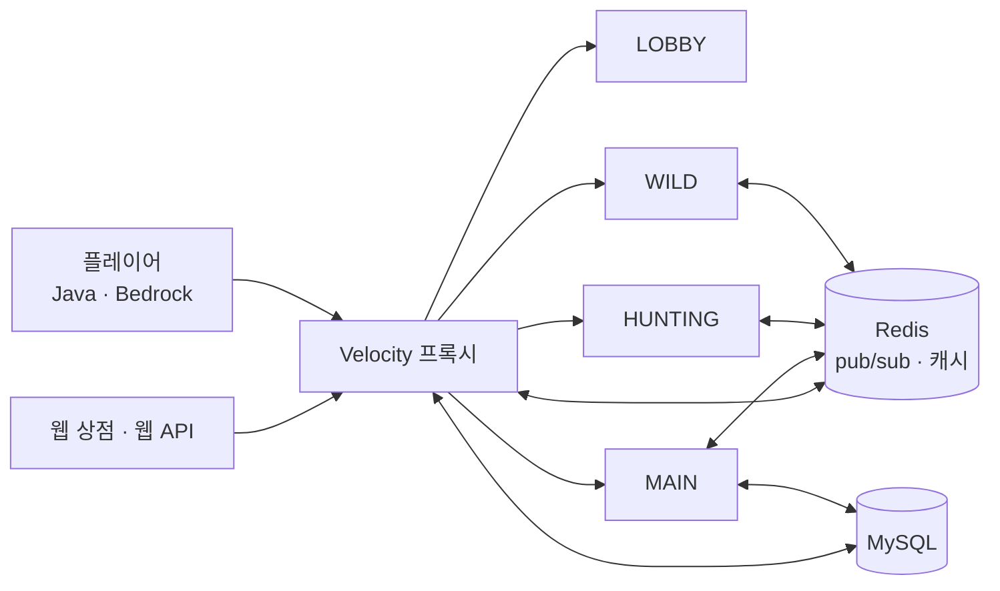

<div align="center">

# XmasLegacy

**얼어붙은 세계에서 다시 시작하는 생존 · 경제 · 대전 마인크래프트 네트워크**


Developed by **Lazberry89**

</div>

---

## 목차

- [스토리](#스토리)
- [컨텐츠](#컨텐츠)
- [서버 구조](#서버-구조)
- [프로젝트 구조](#프로젝트-구조)
- [LazberryRegistryFramework](#lazberryregistryframework)
- [빌드와 실행](#빌드와-실행)
- [주요 명령어](#주요-명령어)

---

## 스토리

> 고대 대백야 시대, 과학자들의 실험 대실패로 이 세계는 생명체가 살 수 없을 정도로 얼어붙어 버렸다.

고대 과학자들은 다가오는 빙하기를 막기 위해 모든 수단을 투자했다.
하지만 이 시도는 오히려 독이 되어, 빙하기와 인간의 종말을 더 가깝게 이끌었다.
기온은 생명체가 살 수 없을 만치 낮아지고, 동식물이 차례차례 멸종하기 시작했으며,
인간의 개체 수 또한 급격히 줄어들기 시작했다.

100년 뒤, 인간의 문명은 흔적도 찾을 수 없이 없어졌다.
본격적인 빙하기가 시작되어 인류는 멸종했을 듯싶었다.

하지만 유일한 생존자들이 살아남아 만든 마을이 바로 **"크리아"** 마을이다.
인간은 쉽게 멸종할 생물이 아니었다. 그들에게 문명의 끝은 새로운 시작이었다.

전자기기와 고도로 발달된 과학에 대한 접근이 없어지자,
크리아의 사람들은 인간에게 자연을 다루는 힘이 있다는 것을 알게 되었다.
이들은 **"기"** 라는 것을 공부하며, 이것을 자신들의 도구에 깃들게 하였다.
또한 직업을 나누어 서로 협력하게 하였다.

사람들은 이런 식으로 살아남으며, 점차 다시 발전하였다. 다른 방향으로.

---

## 컨텐츠

야생에서 살아남는 것뿐 아니라 직접 경제활동에 참여하고, 유저와 겨뤄 보며, 다양한 체험을 해 볼 수 있습니다.

### 생존

| 컨텐츠 | 설명 |
| --- | --- |
| **체온 · 빙결** | 얼어붙은 세계의 추위가 빙결 수치로 쌓입니다. 온기 구역에서 몸을 녹여야 합니다. |
| **기절** | 쓰러진 플레이어는 바로 죽지 않고 기절 상태가 됩니다. |
| **데스박스** | 사망 시 아이템이 상자에 보관됩니다. |
| **에어드랍** | 주기적으로 보급품이 떨어집니다. |
| **가방** | 유저별 개인 저장공간입니다. 인벤토리가 가득 차면 보상이 가방으로 들어갑니다. |

### 직업과 성장

| 직업 | 특징 |
| --- | --- |
| **농부** | 농사 시 추가 경험치, 작물 판매 추가금 |
| **광부** | 채광 시 추가 아이템과 경험치, 광물 판매 추가금 |
| **어부** | 낚시 버프, 생선 판매 추가금 |
| **사냥꾼** | 사냥 시 추가 아이템과 경험치 |
| **대장장이** | 어디서든 무기 강화 |

- **직업 숙련도**: `BEGINNER` → `BRONZE` → `SILVER` → `GOLD` → `CRYSTAL` → `EMERALD` → `INSANE` → `IMMORTAL` → `INFINITE`
- **티어**: `VISITOR` → `USER` → `NEIGHBOR` → `CELEBRITY` → `HERO` → `MYTHIC` → `LEGENDARY` → `OVERLORD` → `ETERNAL`
- **강화**: 강화 재료와 보호 아이템으로 장비를 강화합니다.
- **랭킹 · 칭호 · 발전과제**: 플레이 기록으로 순위를 겨루고 칭호를 얻습니다.

### 전투

| 컨텐츠 | 설명 |
| --- | --- |
| **1대1 대전** | 카지노 코인을 걸고 겨루는 결투입니다. 관전자는 승자에 베팅할 수 있습니다. |

### 경제

| 컨텐츠 | 설명 |
| --- | --- |
| **화폐** | 달러 기반 경제와 송금 |
| **주식** | 시세가 변동하는 주식을 사고팝니다. 월드에 시세 디스플레이가 표시됩니다. |
| **직업 상점** | 직업별 판매 · 구매 상점 |
| **쇼케이스 상점** | 진열대 형태의 상품 판매 |
| **카지노** | 슬롯머신, 동전 던지기, 대전 베팅. 입장권이 필요합니다. |
| **가챠** | 등급별 뽑기 |
| **광산** | 자동으로 재생성되는 채광 구역 |

### 건축과 영역

| 컨텐츠 | 설명 |
| --- | --- |
| **설계도** | 건축물을 설계도로 저장하고, 미리보기 후 건설합니다. |
| **구역** | 땅을 보호하고 유저별 권한을 설정합니다. |
| **텔레포터 · 포탈** | 지점 간 이동과 서버 간 이동 |

### 커뮤니티

- **파티**: 생성, 초대, 추방. 파티장이 서버를 옮기면 파티원이 함께 이동합니다.
- **TPA**: 다른 서버에 있는 유저에게도 텔레포트를 요청할 수 있습니다.
- **채팅**: 서버 간 전체 채팅, 귓말, 욕설 필터
- **문의**: 게임 안에서 관리자에게 문의하고 답변을 받습니다.
- **치장**: 머리 장식 등 코스메틱
- **Java · Bedrock 동시 지원**: Floodgate로 모바일 유저도 접속합니다.

### 웹 연동

- **사전예약 · 서버 정보 · 접속 인원**을 웹 API와 주고받습니다.
- **후원 상품 지급**: 웹 상점에서 결제하면 프록시가 구매를 기록하고, 플레이어가 있는 서버에서 지급합니다. 오프라인이면 다음 접속 때 지급합니다.

---

## 서버 구조

여러 Paper 서버가 Velocity 프록시 아래에 묶여 있고, Redis와 MySQL을 공유합니다.



| 서버 | 역할 |
| --- | --- |
| `LOBBY` | 접속 대기 공간 |
| `MAIN` | 마을, 상점, 카지노 등 중심 컨텐츠 |
| `HUNTING` | 사냥터 |
| `WILD` | 야생 생존 |

- **Redis**: 서버 간 채팅, 귓말, 파티, TPA, 후원 지급 신호와 유저 캐시
- **MySQL**: 유저 정보, 가방, 랭킹, 문의, 구매 기록

---

## 프로젝트 구조

Gradle 멀티 모듈 프로젝트입니다.

```
XmasLegacy/
├── common/     서버 종류와 무관한 공용 코드
│   └── 유저 · 파티 · 랭킹 · 문의 · 후원 기록 · Redis · 프레임워크 어노테이션
├── paper/      게임 서버 플러그인 (컨텐츠 대부분)
│   └── 직업 · 강화 · 사냥터 · 주식 · 카지노 · 설계도 · 구역 · …
└── velocity/   프록시 플러그인
    └── 서버 간 TPA 이동 · 후원 명령 수신
```

| 모듈 | 대상 | 결과물 |
| --- | --- | --- |
| `common` | 라이브러리 | paper · velocity에 포함됨 |
| `paper` | Paper 1.21.11 | `paper/build/libs/` |
| `velocity` | Velocity 3.5.0 | `velocity/build/libs/XmasVelocity.jar` |

---

## LazberryRegistryFramework

이 프로젝트는 직접 만든 의존성 주입 프레임워크 위에서 동작합니다.
어노테이션만 붙이면 클래스가 스캔되어 컨테이너에 등록되고, 리스너와 명령어도 자동으로 연결됩니다.

```java
@Listeners
@Components.Exclude(type = ServerType.LOBBY)   // 로비 서버에서는 등록하지 않음
public class DonationJoinListener implements Listener {
    private final ProductActionManager actionManager;

    @Inject                                     // 생성자 주입
    public DonationJoinListener(ProductActionManager actionManager) {
        this.actionManager = actionManager;
    }
}
```

| 어노테이션 | 역할 |
| --- | --- |
| `@Components` · `@Components.Include` · `@Components.Exclude` | 컨테이너 등록, 서버 종류별 포함 · 제외 |
| `@Inject` | 생성자 주입 |
| `@ConfigValue(path = "...")` | `config.yml` 값을 생성자 인자로 주입 |
| `@Listeners` · `@Commands` · `@Task` | 리스너 · 명령어 · 반복 작업 자동 등록 |
| `@Priority` | `Initiator`의 초기화 · 종료 순서 (`FAST` → `AVERAGE` → `SLOW` → `DELAYED`) |
| `@Monitor` | 메서드 성능 측정 |

---

## 빌드와 실행

### 요구 사항

- **Java 21**
- **Redis** (`localhost:6379`)
- **MySQL**
- **Paper 1.21.11** 서버와 **Velocity 3.5.0** 프록시
- 필수 플러그인: `floodgate`, `WorldEdit`
- 선택 플러그인: `Oraxen`, `UltimateAdvancementAPI`, `LuckPerms`

### 빌드

```bash
./gradlew :paper:shadowJar :velocity:shadowJar
```

### 설정

Paper 서버의 `config.yml`에서 서버 종류와 DB 접속 정보를 지정합니다.

```yaml
server-type: "main"        # lobby · main · hunting · wild

web:
  api_internal_key: ""     # 웹 API 내부 키
  database:
    url: "jdbc:mysql://localhost:3306/xmas_legacy"
    user: ""
    password: ""
```

Velocity는 첫 실행 때 `plugins/xmaslegacy-velocity/config.yml`이 생성됩니다. 여기에도 `web.database` 항목을 채워야 합니다.

---

## 주요 명령어

### 유저

| 명령어 | 설명 |
| --- | --- |
| `/파티` · `/party` · `/pt` | 파티 생성, 초대, 나가기, 추방 |
| `/tpa <플레이어>` · `/tpaccept` | 텔레포트 요청과 수락 |
| `/귓` · `/whisper` · `/w` | 귓말 |
| `/가방` | 개인 저장공간 열기 |
| `/문의 <내용>` · `/문의함` | 관리자 문의와 답변 확인 |
| `/직업선택` | 직업 선택 |
| `/주식` · `/stock` | 주식 조회와 매매 |
| `/prefix inv` | 칭호 설정 |

### 관리자

| 명령어 | 설명 |
| --- | --- |
| `/currency` | 화폐 지급, 차감, 설정, 송금 |
| `/role` | 직업 강제 변경 |
| `/구역` · `/zone` · `/mine` · `/portal` | 구역, 사냥터, 광산, 포탈 설정 |
| `/blueprint` · `/bp` | 설계도 생성과 관리 |
| `/gacha` · `/casino` · `/goods` | 가챠, 카지노, 상점 상품 설정 |
| `/rank` · `/log` · `/filter` | 랭킹, 로그 검색, 욕설 필터 |
| `/vanish` | 관리자 은신 |
| `donation` (프록시 콘솔) | 웹 상점의 후원 상품 지급 |

---

<div align="center">

**XmasLegacy** · `12.25.0.6.dev`

</div>
