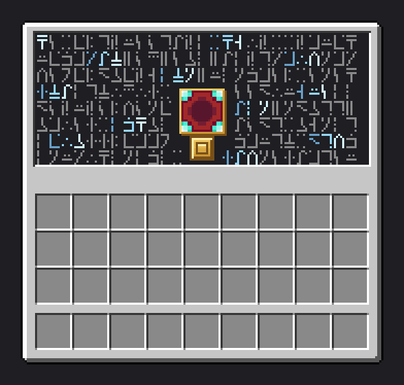

# 강화창 애니메이션 배경 Oraxen 등록 가이드

강화창(27칸 상자) 위쪽에 인챈트 문자가 하나씩 얼어붙는 애니메이션 배경을 Oraxen 글리프로 띄우는 방법입니다.



## 왜 Oraxen을 쓰나

마크 기본 폰트(bitmap provider)는 애니메이션을 지원하지 않습니다. `XmasResourcePack`의 `xmaslegacy:gui` 폰트로 띄우는 지금 방식은 **정지 이미지만** 됩니다.

Oraxen의 애니메이션 글리프는 `rendertype_text` 코어 셰이더로 프레임을 바꿔서, 서버 부담 없이 클라이언트에서 부드럽게 움직입니다.

## 이 폴더 구성

```
XmasResourcePack/oraxen/
├── README.md                              이 문서
├── enchant_forge_preview.gif              미리보기 (아래 인벤토리는 바닐라)
├── glyphs/xmaslegacy_gui.yml              글리프 설정 (복사용)
└── pack/textures/xmaslegacy/enchant_forge.png   스프라이트 시트
```

`oraxen/` 폴더는 Oraxen에 넣을 원본을 모아 둔 것이고, `XmasResourcePack.zip`에는 포함되지 않습니다.

## 스프라이트 시트 규격

> **각 프레임의 맨 오른쪽 열(x=175)은 반드시 투명이어야 합니다.**
> Oraxen은 프레임 사이에 `-(프레임 너비)` = -176 간격을 넣어 프레임을 겹치는데, 마크는 그림 글자 뒤에 1px를 더 붙입니다. 마지막 열에 픽셀이 있으면 글자 폭이 177이 되어 프레임마다 1px씩 오른쪽으로 밀립니다(15프레임째 15px). 이 열은 바닐라 상자 테두리와 같은 검은 선이라 비워도 아래 바닐라 창이 똑같이 보입니다.

| 항목 | 값 |
|---|---|
| 한 프레임 | 176 × 71 (3줄 상자의 위쪽 컨테이너 부분과 같은 크기) |
| 프레임 수 | 16 (Oraxen 최대값) |
| 배치 | 위에서 아래로 세로로 이어 붙임 |
| 전체 크기 | 176 × 1136 |

Oraxen 문서 기준 조건입니다.
- `frames`는 **최대 16**이고, 넘는 프레임은 경고와 함께 버려집니다.
- 시트의 가로나 세로가 프레임 수로 **나누어떨어져야** 합니다. 세로 시트와 가로 시트 둘 다 지원합니다.
- 프레임이 정사각형일 필요는 없습니다.

## 등록 순서

### 1. 파일 복사

| 이 폴더의 파일 | 서버에 넣을 위치 |
|---|---|
| `pack/textures/xmaslegacy/enchant_forge.png` | `plugins/Oraxen/pack/textures/xmaslegacy/enchant_forge.png` |
| `glyphs/xmaslegacy_gui.yml` | `plugins/Oraxen/glyphs/xmaslegacy_gui.yml` |

### 2. 글리프 설정

`glyphs/xmaslegacy_gui.yml` 내용입니다.

```yaml
enchant_forge:
  texture: xmaslegacy/enchant_forge
  animation:
    frames: 16
    fps: 8
    loop: true
  ascent: 13
  height: 71
```

| 필드 | 의미 |
|---|---|
| `texture` | `pack/textures/` 기준 경로. 확장자는 쓰지 않음 |
| `animation.frames` | 프레임 수 (최대 16) |
| `animation.fps` | 초당 프레임 (1~127, 기본 10) |
| `animation.loop` | 반복 여부 (기본 true) |
| `animation.offset` | 마지막 프레임 뒤에 한 번 붙는 간격. 프레임 사이 간격과는 무관하므로 쓰지 않음 |
| `ascent` | 세로 위치. 13이 상자 창 맨 위에 맞는 값 |
| `height` | 한 프레임의 높이. `ascent`보다 크거나 같아야 함 (마크 규칙) |

`char`는 쓰지 않았습니다. 지금 설정(`disable_automatic_glyph_code: false`)이면 Oraxen이 자동으로 문자를 배정합니다. 채팅용이 아니라서 `chat.placeholders`도 넣지 않았습니다.

### 3. 셰이더가 지워지지 않게 확인

애니메이션은 코어 셰이더로 동작합니다. `plugins/Oraxen/settings.yml`에서 아래 값이 `false`인지 확인하세요. 지금 더미 설정은 `false`입니다.

```yaml
Pack:
  import:
    remove_core_shaders_from_imported_packs: false
```

`rendertype_text` 셰이더를 덮어쓰는 다른 리소스팩(텍스트 효과 팩 등)을 함께 쓰면 애니메이션이 깨질 수 있습니다.

### 4. 팩 재생성

```
/oraxen reload all
```

### 5. 강화창 제목 바꾸기

Oraxen은 GUI 제목 안의 글리프 태그를 처리합니다. 창 왼쪽 끝에 맞추려면 앞에 `-8` 간격을 둡니다.

```
<shift:-8><glyph:enchant_forge>
```

- `<shift:N>`은 음수도 됩니다. 줄임형은 `<s:N>`, 글리프 줄임형은 `<g:name>`입니다.
- Paper 1.21.2 이상에서는 Oraxen이 GUI 제목 태그를 자체 패킷 처리로 바꿉니다. 이보다 낮으면 PacketEvents가 필요합니다.
- 더미 설정의 `main_menu_title: <shift:-18><glyph:menu_items><shift:-193>`이 같은 방식의 예입니다.

코드에서는 지금 `EnchantUserInterface.customTitle()`이 `xmaslegacy:gui` 폰트 글자를 넣고 있습니다. Oraxen 방식으로 바꾸면 이 부분을 위 태그 문자열로 바꾸면 됩니다. 그러면 `XmasResourcePack`의 `xmaslegacy:gui` 폰트와 정지 이미지 `forge.png`는 더 쓰이지 않습니다. 정지 이미지는 Oraxen이 없는 환경용 대체품으로 남겨 둬도 됩니다.

## 애니메이션 동작

- 배경의 인챈트 문자 185개가 읽는 순서대로 번호가 붙어 있습니다.
- 매 프레임 다음 글자가 얼음색으로 얼고, 다음 두 프레임 동안 녹아 연한 회색으로 돌아갑니다.
- 16프레임에 모든 글자를 하나씩 돌리면 185프레임이 필요하므로, **16칸 간격으로 여러 글자가 동시에** 한 칸씩 전진합니다. 16프레임이 지나면 모든 글자가 한 번씩 얼어서 끊김 없이 반복됩니다.

## 확인이 필요한 것

| 항목 | 상태 |
|---|---|
| 정지 이미지로 창 위치(`ascent: 13`, `-8` 간격) | 게임에서 확인됨 |
| 1.21.11 리소스팩 포맷 75, 보스바 경로 | 클라이언트 jar에서 확인됨 |
| `frames` 최대 16, 시트 나눗셈 조건, `fps` 범위 | Oraxen 공식 문서로 확인 |
| 실서버 Oraxen이 `animation:` 블록을 지원하는지 | 더미 설정(실서버 복사본)에 예시가 있어 지원하는 것으로 보임 |
| 애니메이션 글리프의 `height`가 한 프레임 높이인지 | 예시(`spinner`: 16프레임, `height: 7`)로 추정. 게임에서 확인 필요 |
| GUI 제목에서 애니메이션 글리프가 움직이는지, 색이 제목 색으로 물드는지 | 미확인. 회색으로 물들면 태그 앞에 `<white>`를 붙여 볼 것 |
| 1.21.11에서 애니메이션 동작 | 미확인. Oraxen README의 지원 범위(Paper 1.20.1~26.3) 안에는 있음 |

## 참고

- Oraxen 글리프 문서: https://docs.oraxen.com/configuration/glyphs
- Oraxen 텍스트 효과(셰이더) 문서: https://docs.oraxen.com/configuration/glyphs/texteffects/
- 더미 설정 예시: `glyphs/animations.yml`의 `spinner`

## 스코어보드 제목 (`sidebar_snow`)

사이드바 제목칸을 눈이 덮고, 그 위에 호랑가시나무·금종 장식과 눈 쌓인 XmasLegacy 로고가 있으며, 아래로 눈이 내리는 애니메이션 글리프입니다.

| 파일 | 서버에 넣을 위치 |
|---|---|
| `pack/textures/xmaslegacy/sidebar_snow.png` (105×944, 16프레임) | `plugins/Oraxen/pack/textures/xmaslegacy/sidebar_snow.png` |
| `glyphs/xmaslegacy_gui.yml`의 `sidebar_snow` 항목 | 같은 yml에 이미 포함 |

- 코드: `UserScoreboard.soloTitle()`이 제목을 `<white><shift:-2><glyph:sidebar_snow><shift:-3>`로 보냅니다. 제목 폭이 정확히 100px가 되고, 그림은 사이드바 상자의 좌우 여백 2px까지 덮습니다.
- 사이드바 줄이 100px보다 길면 상자가 넓어지고 눈은 가운데만 덮습니다.
- 프레임 24번째 줄이 제목칸 맨 위(`ascent: 32`)입니다. 위 14줄은 로고(글자가 튀어오를 2줄 포함), 그 아래는 장식입니다.
- 로고는 X→y 순서로 6프레임, y→X 순서로 6프레임 동안 한 글자씩 2px 튀어올랐다 내려오고(이웃 글자는 1px), 마지막 3프레임(6fps 기준 0.5초)은 멈춰 있습니다. 눈송이는 제목칸 아래로 32px 구간을 한 프레임에 2px씩 떨어집니다.
- 강화창과 같은 규칙으로 각 프레임의 마지막 열(x=104)은 비어 있습니다.
- Bedrock 유저와 파티 보드는 기존 텍스트 제목을 씁니다. 26.2 이상 클라이언트에서는 분홍색으로 깨집니다(강화창과 같은 Oraxen 셰이더 문제).
- 원본과 생성 스크립트: `design/scoreboard/`

## ESC 메뉴 로고 (`menu_logo`)

일시정지(ESC) 메뉴 맨 위 제목 자리에 뜨는 XmasLegacy 로고입니다. 지금 뜨는 피카츄 그림은 Oraxen 기본 글리프 `logo`이고, Oraxen이 언어 파일로 메뉴 제목(`menu.game`)을 그 글리프로 바꿔서 나옵니다.

| 파일 | 서버에 넣을 위치 |
|---|---|
| `pack/textures/xmaslegacy/menu_logo.png` (160×45) | `plugins/Oraxen/pack/textures/xmaslegacy/menu_logo.png` |
| `glyphs/xmaslegacy_gui.yml`의 `menu_logo` 항목 | 같은 yml에 이미 포함 |

언어 파일 수정 (`plugins/Oraxen/pack/lang/`):

1. `global.json`의 `"menu.game": "<glyph:logo>"`를 `"menu.game": "<glyph:menu_logo>"`로 바꿉니다. 모든 언어에 적용됩니다.
2. `en_us.json`에도 `"menu.game": "<glyph:logo>"`가 따로 있어서, 영어 클라이언트는 이 값이 우선합니다. 여기도 똑같이 바꿉니다.
3. (선택) 버튼 문구 `"menu.returnToGame": "Back to the Oraxen experience"`도 원하는 문구로 바꿀 수 있습니다. 예: `global.json`에 `"menu.returnToGame": "게임으로 돌아가기"`.
4. `/oraxen reload all` 후 재접속합니다.

위치가 위아래로 어긋나면 `ascent`만 조절하면 됩니다. 숫자가 클수록 위로 올라갑니다.

## 종료 아이콘 (`required/exit_icon.png`)

Oraxen 필수 텍스처입니다. 두 군데에 쓰입니다.

- `glyphs/required.yml`의 `required` 글리프(`ascent 8`, `height 8`). 다른 글리프의 텍스처가 없을 때 대신 표시되는 글자이기도 해서, 이 이미지가 피카츄면 메뉴 제목이나 종료 버튼에 피카츄가 뜹니다.
- Oraxen 아이템 창의 "Back to main menu" 버튼 아이템(`item/generated`).

| 파일 | 서버에 넣을 위치 |
|---|---|
| `pack/textures/required/exit_icon.png` (8×8, 빨간 X) | `plugins/Oraxen/pack/textures/required/exit_icon.png` 덮어쓰기 |

- 글리프 높이(8)에 맞춰 8×8로 직접 찍었습니다. 1픽셀 = GUI 1픽셀이라 줄어들며 뭉개지지 않습니다. 아이템으로 쓰일 때는 그대로 확대되어 보입니다.
- `required.yml`은 수정하면 Oraxen이 다시 만들어 버리므로 건드리지 않습니다. 이미지 파일만 바꿉니다.
- 원본과 스크립트: `design/menu/exit_icon_x8.png`, `exit_x8.py` (다른 시안: `exit_icon.png` 눈 버튼, `exit_icon_power.png` 전원, `exit_icon_x.png` 16px X)
